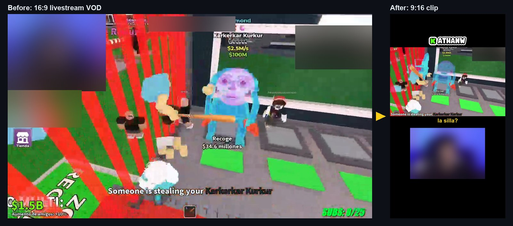
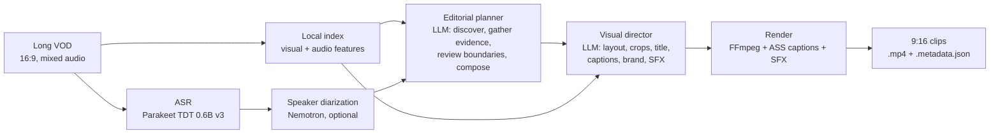

# ClipperX

**Turn multi-hour livestream VODs into vertical, captioned, ready-to-post short clips, on your own GPU.**



<sub>Frame from one of my own streams. Faces and other players' names are blurred. The right side is real output of the current compatibility renderer, an earlier iteration: the adaptive v2 layout is still in progress (see <a href="#project-status">Project status</a>).</sub>

## Why

Streamers grow on TikTok, YouTube Shorts and Reels, but turning a 6-hour stream into good clips is slow manual work:

- watching the whole VOD to find the moments;
- trimming without losing the setup or the payoff;
- reframing 16:9 into 9:16;
- timing captions word by word;
- adding a title and branding.

The tools that already exist mostly cut fixed-length windows around loud audio or chat spikes. ClipperX tries to **understand what actually happened** and then edit the clip the way a human clip editor would.

## Features

- **Long-form input.** Built for 30-minute to 10-hour VODs with a single mixed audio track. Every stage is cached and resumable.
- **Local speech stack.** NVIDIA Parakeet ASR with native word timestamps. Optional Nemotron speaker diarization and voiceprint matching for the streamer.
- **Local visual index.** Sparse sampling plus dense probes around scene changes. Face and webcam tracking (YuNet + SFace) with explicit `confident` / `ambiguous` / `unavailable` states.
- **LLM editorial planner.** Token-budgeted batches, candidate discovery, evidence requests (frames and audio around a moment), and boundary review that can split, merge or extend clips. In coverage mode it returns every moment it can justify, not a fixed quota. Clips are capped at 179 s.
- **LLM visual director.** Chooses a layout per shot (camera, content, split, full-cam), crops, title, captions, branding and optional SFX cues. A creator gate refuses to publish a clip that is missing branding or captions.
- **FFmpeg renderer.** 1080x1920 H.264/AAC output, word-timed ASS captions, overlays and audio checks. Each clip comes with a `.metadata.json`.
- **Strict contracts and safety rails.** Every model decision is a Pydantic-validated JSON schema. There are no silent fallbacks, and no inference is sent without `--confirm-inference` and hard token and call limits.

## Architecture



Deterministic stages (indexing, ASR, geometry, render) are cached per VOD fingerprint. The LLM stages only return structured decisions, and the host validates them before anything is rendered. Cursors, receipts, token usage and decisions are persisted, so an interrupted run resumes without paying for the same model calls twice.

## Tech stack

| Area | Tools |
|---|---|
| Language | Python 3.12 (Windows 11, CUDA) |
| Speech | NVIDIA Parakeet TDT 0.6B v3, NVIDIA Nemotron diarization, WhisperX / pyannote (optional legacy backends) |
| Vision | OpenCV (YuNet face detection, SFace identity), MediaPipe |
| LLM | Any OpenAI-compatible API with JSON-schema output and image input (hosted or local, e.g. Ollama) |
| Contracts | Pydantic v2, tiktoken for context budgeting |
| Media | FFmpeg (H.264 NVENC or libx264, AAC), ASS subtitles |
| CLI / UI | Typer, Rich, Textual |
| Tests | pytest |

## Quickstart

Requirements: Windows 10/11, Python 3.12 (`python` on `PATH`; 3.11 is the minimum for the model-download script), an NVIDIA GPU with a CUDA 12.4-capable driver, and FFmpeg (`ffmpeg` and `ffprobe`) on `PATH`.

Run the setup scripts in this order: the speech environment is created from the main one.

```powershell
git clone https://github.com/AthanWs/ClipperX.git
cd ClipperX

# Main environment .venv-whisperx (render, indexing, planner); ends by running `doctor`
powershell -ExecutionPolicy Bypass -File scripts\setup_env.ps1
# Local speech stack .venv-nvidia-speech (Parakeet + Nemotron) and its pinned models
powershell -ExecutionPolicy Bypass -File scripts\setup_nvidia_speech.ps1 -DownloadModels
# Optional: pyannote Community-1 runtime, only for DIARIZATION_BACKEND=pyannote (needs HF_TOKEN)
# powershell -ExecutionPolicy Bypass -File scripts\setup_diarization_env.ps1

Copy-Item .env.example .env   # every variable is described in .env.example
$py = ".\.venv-whisperx\Scripts\python.exe"

& $py -m clipperx.cli doctor                         # check the local runtime (no LLM)
# setup-face-models only downloads when ALLOW_MODEL_DOWNLOADS=true is set in .env
& $py -m clipperx.cli setup-face-models              # one-time download of YuNet/SFace
& $py -m clipperx.cli index-visual VOD.mp4           # local visual index (no LLM)
& $py -m clipperx.cli transcribe VOD.mp4             # local ASR with word timestamps
```

To run the full workflow (planner → director → export), set an OpenAI-compatible provider in `.env`:

```ini
LLM_PROVIDER=openai_compatible
OPENAI_BASE_URL=https://your-endpoint/v1
OPENAI_API_KEY=...
OPENAI_MODEL=your-model-name
```

Then run it:

```powershell
& $py -m clipperx.cli auto-edit VOD.mp4 --output-dir out\clips `
    --model your-model-name --encoder libx264 --confirm-inference
```

`python -m clipperx.cli --help` lists all commands, including step-by-step ones such as `prepare-batches`, `plan-visual` and `render-visual-plan`.

## Troubleshooting

Start with `.\.venv-whisperx\Scripts\python.exe -m clipperx.cli doctor` (add `--json` for details). It runs no model and lists every failing check.

| Symptom | Likely cause and fix |
|---|---|
| `running scripts is disabled on this system` | PowerShell execution policy. Run the scripts as shown above, with `powershell -ExecutionPolicy Bypass -File ...`. |
| `setup_env.ps1` fails on `python -m venv`, or creates an environment with the wrong Python | The script uses whichever `python` is first on `PATH`. Create the environment yourself with the right version (`py -3.12 -m venv .venv-whisperx`) and run the script again; it reuses an existing `.venv-whisperx`. |
| `doctor` reports `ffmpeg` / `ffprobe` as failed | FFmpeg is not on `PATH`. Install a full build (for example `winget install Gyan.FFmpeg`), open a **new** terminal and check `ffmpeg -version` and `ffprobe -version`. |
| `doctor` reports `cuda` with `available=False` | A CPU-only Torch wheel was installed, or the NVIDIA driver is too old for CUDA 12.4. Check `nvidia-smi`, update the driver, then re-run `scripts\setup_env.ps1` (it force-reinstalls the `cu124` wheels at the end). |
| `doctor` reports an `opencv distribution` conflict | Both `opencv-python` and `opencv-contrib-python` are installed. Run `.\.venv-whisperx\Scripts\python.exe -m pip uninstall -y opencv-python` and keep only the contrib package. |
| `h264_nvenc` not available | Your FFmpeg build or GPU has no NVENC. Pass `--encoder libx264` to `auto-edit`. |
| `setup_nvidia_speech.ps1`: `Runtime creation failed` | `.venv-whisperx` does not exist yet. Run `scripts\setup_env.ps1` first. |
| `setup_nvidia_speech.ps1`: `NVIDIA speech runtime CUDA preflight failed` | Torch in `.venv-nvidia-speech` cannot see the GPU. Same fix as the `cuda` check above; delete `.venv-nvidia-speech` and run the script again. |
| `setup_nvidia_speech.ps1` fails opening `.nvidia-speech-setup.lock` | Another run of the script is still active. Wait for it or close it, then retry. |
| `Faltan o son inválidos los modelos faciales` / `El manifest facial está ausente` | Face models are missing or unverified. Set `ALLOW_MODEL_DOWNLOADS=true` in `.env` and run `python -m clipperx.cli setup-face-models`. |
| `Falta el runtime aislado de Community-1` | `DIARIZATION_BACKEND=pyannote` is set but `.venv-diarization` is missing. Run `scripts\setup_diarization_env.ps1`, or switch back to `DIARIZATION_BACKEND=nemotron`. |
| `Configura LLM_PROVIDER antes de confirmar inferencia` | `LLM_PROVIDER=disabled` in `.env`. Set an OpenAI-compatible provider as shown in [Quickstart](#quickstart). |
| `Falta --confirm-inference` | Commands that call the model require the explicit `--confirm-inference` flag. |

## Testing

The repo has **3,897 pytest tests in 88 files**. They use real files, ledgers and Pydantic schemas, and fake only the external model boundary.

```powershell
.\.venv-whisperx\Scripts\python.exe -m pytest clipperx/tests -q
```

On a fresh clone, 3,582 pass, 8 are skipped and the remaining ~300 fail or error. Most of those depend on machine-local assets that are not committed:

- a pinned FFmpeg build under `data/tools/`;
- validation fixtures under `data/`;
- internal design records.

Making the suite fully self-contained is on the roadmap.

## Project status

ClipperX is an **active work in progress**.

**Working (implemented and covered by tests):**
- Local visual and audio indexing, face/webcam identity with explicit uncertainty.
- Parakeet ASR with chunked long-form processing and native word timestamps; optional Nemotron diarization.
- Staged editorial planner with resumable ledgers, evidence requests, boundary review and coverage mode.
- Visual director contracts and creator publication gate; resumable per-clip export coordinator.
- Compatibility renderer with styled captions and branding (shown in the demo above).

**In progress / not yet proven:**
- End-to-end autonomous editing of a full multi-hour VOD with real model calls. So far only bounded real-model samples have been run.
- The v2 director reliably placing overlays in genuinely free regions on every layout, and native 60 FPS v2 rendering.
- Measured editorial quality at scale: highlight precision, natural cuts, false positives.

## Roadmap

1. **End-to-end runs on real VODs** with a human review loop feeding fixes back into prompts and validators.
2. **Human-style finishing:** motivated zooms and punch-ins, event-driven sound design, and better use of empty space in the 9:16 frame.
3. **Titles and on-screen text** modeled on real short-form clip conventions: hooks, quotes, reaction framing.
4. **Self-contained test suite** (small committed fixtures, FFmpeg discovered from `PATH`).
5. **UI** switched from the legacy pipeline to the new autonomous workflow.
6. **Synchronized chat** as an extra signal, and newer local speech models as consumer-GPU builds appear.

**Research note:** `tools/` contains a closed experiment that used Meta's TRIBE v2 brain-encoding model to predict engagement. The first batch looked promising (ρ ≈ 0.54, n = 21) but **did not replicate** on fresh, pre-registered data (ρ ≈ 0.10, n = 36), so it was not integrated.

## Built with Claude Code

ClipperX is developed with [Claude Code](https://claude.com/claude-code) as a day-to-day engineering partner:

- **Planning.** Features start as written specs and implementation plans: [`docs/superpowers/specs`](docs/superpowers/specs) and [`docs/superpowers/plans`](docs/superpowers/plans).
- **Implementation.** Small, scoped tasks with explicit file ownership. The work is test-first: a failing test, then the fix, then a focused regression run.
- **Testing and verification.** Claude Code runs the suites, renders real samples and inspects output frames and audio before a change counts as done. Results are recorded honestly as implemented, tested without a model, or validated with the model.
- **Review.** Independent review passes over each change set (diffs, edge cases, contract drift) before it is accepted.

## License

ClipperX is licensed under the [Mozilla Public License 2.0](LICENSE). Copyright (c) 2026 AthanWs.

The MPL is a file-level copyleft license: you can use, modify and redistribute ClipperX, but if you distribute a modified version, those modified files must remain under the MPL 2.0 and their source must be made available.

---

<sub>**Resumen en español:** ClipperX convierte directos largos en clips verticales listos para publicar. Usa ASR y diarización locales, un planner editorial con LLM y un director visual, y renderiza con FFmpeg. Es un proyecto en desarrollo activo, hecho con Claude Code.</sub>
